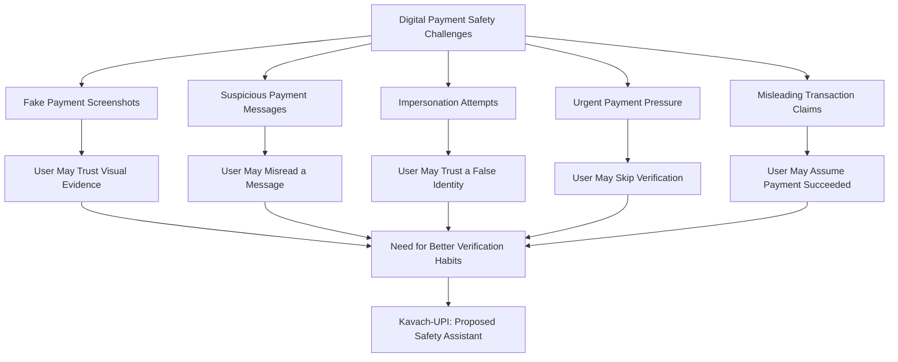
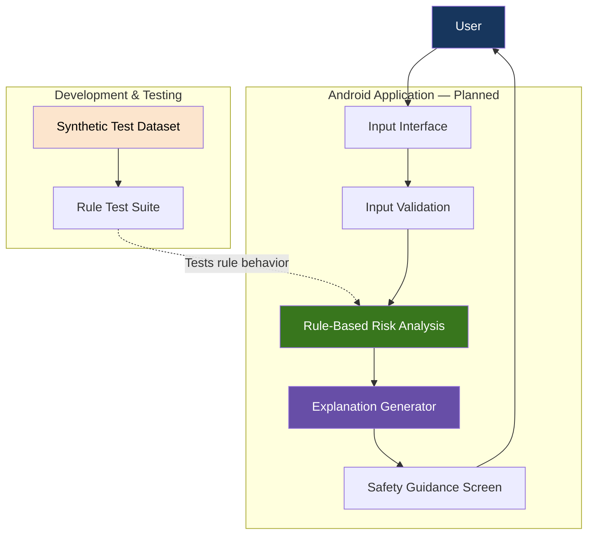
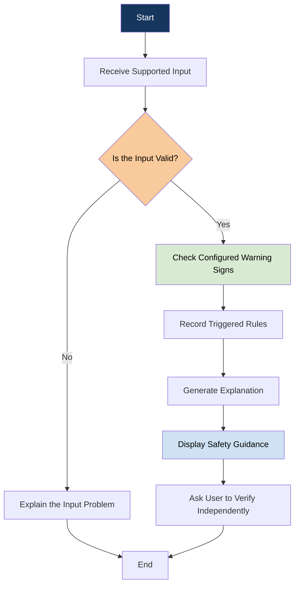
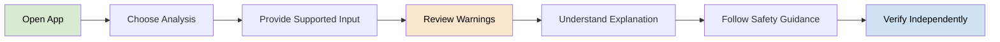
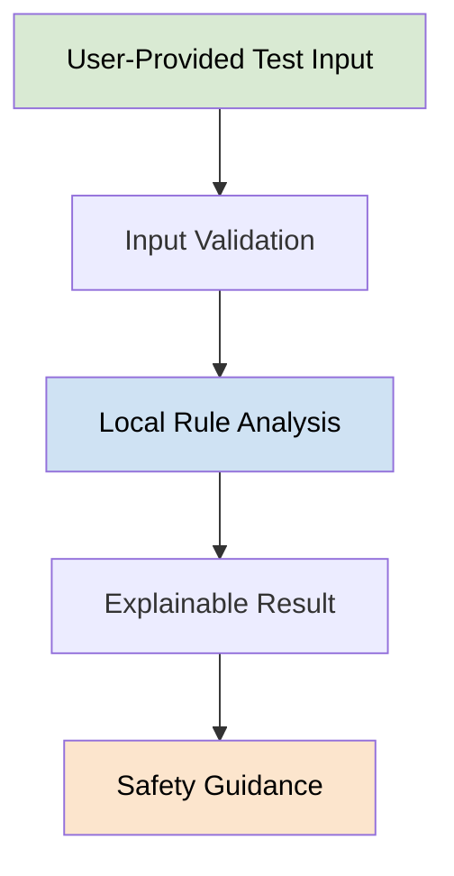
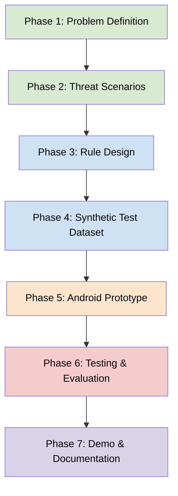

<div align="center">

# 🛡️ Kavach-UPI

### Explainable UPI Fraud-Risk Analysis & Digital Payment Safety

**Think Before You Trust. Verify Before You Pay.**

An educational cybersecurity project designed to help people recognize
suspicious digital payment situations through explainable risk indicators
and practical safety guidance.


**Project Type:** Student Innovation | Cybersecurity | Digital Safety

</div>

---

# 📌 Table of Contents

- [1. Project Overview](#-1-project-overview)
- [2. The Problem](#-2-the-problem)
- [3. Our Proposed Solution](#-3-our-proposed-solution)
- [4. Project Mind Map](#-4-project-mind-map)
- [5. System Architecture](#-5-system-architecture)
- [6. Fraud-Risk Analysis Workflow](#-6-fraud-risk-analysis-workflow)
- [7. Detection Rules](#-7-proposed-detection-rules)
- [8. Explainable Risk Assessment](#-8-explainable-risk-assessment)
- [9. User Journey](#-9-user-journey)
- [10. Technology Stack](#-10-technology-stack)
- [11. Privacy and Security](#-11-privacy-and-security)
- [12. Testing Strategy](#-12-testing-strategy)
- [13. Development Roadmap](#-13-development-roadmap)
- [14. Limitations](#-14-limitations)
- [15. Future Scope](#-15-future-scope)
- [16. Contributing](#-16-contributing)

---

# 🎯 1. Project Overview

Kavach-UPI is a proposed Android-based cybersecurity prototype focused
on digital payment safety and explainable fraud-risk analysis.

Digital payment users may encounter fake payment screenshots,
suspicious payment messages, impersonation attempts, and misleading
claims that a transaction has succeeded.

Kavach-UPI aims to help users understand warning signs and make
more informed decisions before trusting suspicious payment information.

## Our Vision

Make digital payment safety easier to understand, accessible to more
people, and practical for everyday use.

## Core Objectives

- Help users recognize potentially suspicious payment situations.
- Explain why a particular message or scenario may be risky.
- Provide actionable digital safety guidance.
- Test detection logic with synthetic, fictional examples.
- Explore privacy-conscious approaches to cybersecurity education.

> Important: Kavach-UPI is an educational prototype, not a bank,
> payment gateway, or official UPI transaction verification service.

---

# 🚨 2. The Problem

Digital payment fraud can exploit trust, urgency, confusion, and a
user's inability to verify a payment claim independently.

## Common Risk Scenarios



## Why This Matters

A payment-related message or screenshot does not independently prove
that money has been transferred.

Users should verify the actual transaction through their official
banking or UPI application.

Kavach-UPI is intended to support safer decision-making, not replace
official transaction verification.

---

# 💡 3. Our Proposed Solution

Kavach-UPI proposes a simple workflow that analyzes selected
information, identifies explainable warning signs, and displays
relevant safety guidance.

## Proposed Features

| Feature | Purpose | Status |
|---|---|---|
| Risk Indicator Engine | Identify configured warning signs | Planned |
| Explainable Results | Explain why a warning appeared | Planned |
| Safety Recommendations | Suggest appropriate verification steps | Planned |
| Synthetic Test Dataset | Test expected detection behavior | Planned |
| Android Interface | Provide a user-friendly experience | Planned |
| Privacy Controls | Minimize unnecessary data collection | Planned |

These features are proposed, not completed or validated.

---

# 🧠 4. Project Mind Map

This diagram shows the major components and intended direction
of the Kavach-UPI project.

```mermaid
flowchart TD
    A["🛡️ Kavach-UPI"]

    A --> B["Problem Understanding"]
    A --> C["Risk Analysis"]
    A --> D["User Experience"]
    A --> E["Privacy & Security"]
    A --> F["Testing & Validation"]

    B --> B1["Fake Payment Claims"]
    B --> B2["Suspicious Messages"]
    B --> B3["Impersonation"]

    C --> C1["Rule-Based Analysis"]
    C --> C2["Risk Indicators"]
    C --> C3["Explainable Results"]

    D --> D1["Simple Android UI"]
    D --> D2["Clear Warnings"]
    D --> D3["Safety Guidance"]

    E --> E1["Data Minimization"]
    E --> E2["Synthetic Examples"]
    E --> E3["Secure Data Handling"]

    F --> F1["Test Cases"]
    F --> F2["False Positive Checks"]
    F --> F3["Documented Limitations"]

    style A fill:#17365D,color:#FFFFFF,stroke:#5B9BD5
    style B fill:#D9EAF7,color:#17365D
    style C fill:#D9EAD3,color:#274E13
    style D fill:#FCE5CD,color:#783F04
    style E fill:#E4DFEC,color:#351C75
    style F fill:#F4CCCC,color:#660000
```



## What Each Branch Means

<details>
<summary><strong>📍 Branch 1 — Problem Understanding</strong></summary>

The project begins by studying common digital payment deception
scenarios.

Examples include suspicious messages, fake payment confirmations,
impersonation, and pressure to act quickly.

The purpose is to define realistic problems instead of building
features without a clear user need.

</details>

<details>
<summary><strong>🔍 Branch 2 — Risk Analysis</strong></summary>

A proposed rule-based engine will examine supported inputs for
specific warning signs.

Each warning should be connected to a reason that users can
understand.

A warning indicates a possible concern, not proof of fraud.

</details>

<details>
<summary><strong>📱 Branch 3 — User Experience</strong></summary>

The proposed Android interface should make results understandable
even for people with limited technical knowledge.

The interface may display the detected warning signs, their
explanations, and recommended verification steps.

</details>

<details>
<summary><strong>🔐 Branch 4 — Privacy and Security</strong></summary>

The prototype should minimize the information it collects and use
fictional test data during development.

Real bank messages, OTPs, account details, and other sensitive
information must not be published in the repository.

</details>

<details>
<summary><strong>🧪 Branch 5 — Testing and Validation</strong></summary>

The project will use synthetic examples to evaluate whether the
configured rules behave as expected.

Testing should include suspicious examples, legitimate examples,
ambiguous cases, and situations where the system cannot reach a
reliable conclusion.

</details>

---

# 🏗️ 5. System Architecture

The following diagram represents the proposed architecture.
It does not indicate that these components have already been built.



## Architecture Components

| Component | Responsibility |
|---|---|
| Input Interface | Accept supported user-provided information |
| Input Validation | Check whether input is suitable for analysis |
| Risk Analysis | Apply configured detection rules |
| Explanation Generator | Describe which rules were triggered |
| Safety Guidance | Display relevant next steps |
| Synthetic Dataset | Supply fictional examples for testing |
| Rule Test Suite | Check expected behavior and regressions |

### Important Architecture Principle

The prototype should not claim to independently verify bank balances
or confirm that a UPI transaction has settled.

Its output is limited to the information and rules actually available
to the application.

---

# 🔎 6. Fraud-Risk Analysis Workflow

The proposed analysis process follows a sequence of understandable
steps.



## Workflow Explanation

1. **Input:** The user provides information supported by the prototype.
2. **Validation:** The application checks whether the input can be processed.
3. **Analysis:** Configured rules examine relevant warning signs.
4. **Explanation:** The application identifies the rules that were triggered.
5. **Guidance:** The user receives relevant safety recommendations.
6. **Verification:** The user checks the transaction through an official source.

If the available information is insufficient, the system should
communicate that limitation rather than invent a conclusion.

---

# 🧩 7. Proposed Detection Rules

The initial version should prioritize understandable rules instead
of claiming advanced AI capabilities without evidence.

| Rule ID | Scenario | Possible Warning | Recommended Action |
|---|---|---|---|
| R-01 | Message asks for an OTP | Sensitive information requested | Never share an OTP |
| R-02 | Message pressures user to act immediately | Urgency-based manipulation | Pause and verify independently |
| R-03 | Someone claims a payment succeeded | Transaction status is unverified | Check the official UPI app |
| R-04 | A message requests a payment or transfer | Payment request needs context | Verify the recipient and purpose |
| R-05 | A message contains suspicious instructions | Possible social engineering | Avoid acting until verified |

These are example scenarios for future implementation, not
validated detection rules.

A legitimate message may contain similar language. Therefore,
individual warning signs should not automatically be treated as
proof of a scam.

## Rule Design Principles

- Each rule must have a documented purpose.
- Each triggered rule should produce an explanation.
- Rules must be tested against legitimate and suspicious examples.
- Ambiguous inputs should not receive unjustified certainty.
- Detection limitations should be documented.

---

# 📊 8. Explainable Risk Assessment

Kavach-UPI aims to explain its findings rather than display an
unexplained score.

## Example Result

The following is a fictional illustration of a future interface.

```text
---------------------------------------
       KAVACH-UPI SAFETY CHECK
---------------------------------------

Input:
A fictional message claiming payment
has been completed.

Observation:
The message alone does not establish
that a transaction succeeded.

Result:
TRANSACTION NOT VERIFIED

Why this result?
The available message is not an
independent source of transaction status.

Recommended action:
Open your official UPI application
and check the actual transaction record.

---------------------------------------
This result is not a bank verification.
---------------------------------------
```

## Proposed Result Categories

- **No configured warning detected:** The rules did not identify a known warning sign.
- **Potential warning detected:** One or more configured rules were triggered.
- **Insufficient information:** The input does not support a meaningful assessment.

These categories describe rule behavior. They do not guarantee that
a transaction or message is safe or fraudulent.

---

# 👤 9. User Journey



## User Experience Goals

- Keep instructions simple and readable.
- Explain warnings using everyday language.
- Avoid unnecessary technical jargon.
- Do not pressure users into making financial decisions.
- Provide an independent verification recommendation.

---

# 🛠️ 10. Technology Stack

| Technology | Intended Purpose |
|---|---|
| Kotlin | Proposed Android application language |
| Android SDK | Android application development |
| Git & GitHub | Version control and collaboration |
| Mermaid | Architecture and workflow diagrams |
| Synthetic Test Data | Safe, fictional test scenarios |
| Rule-Based Logic | Explainable warning detection |

The final technology choices may change as development progresses.

No external banking integration or transaction verification capability
is claimed at this stage.

---

# 🔐 11. Privacy and Security

Privacy should be considered from the beginning of development.

## Proposed Safeguards

- Use fictional examples during testing.
- Collect only the information necessary for a defined feature.
- Avoid storing sensitive payment information unnecessarily.
- Never request or collect UPI PINs or OTPs.
- Never publish personal bank messages or financial records.
- Keep API keys, passwords, and credentials out of GitHub.
- Explain how user-provided information is processed.

## Data Flow Principle



This illustrates a proposed local-processing approach. Actual data
handling must be confirmed from the implemented code.

---

# 🧪 12. Testing Strategy

The project will use synthetic examples to test its behavior.

## Planned Test Categories

| Test Category | What It Evaluates |
|---|---|
| Suspicious Examples | Whether relevant configured warnings appear |
| Legitimate Examples | Whether ordinary inputs trigger unnecessary warnings |
| Ambiguous Examples | Whether uncertainty is communicated appropriately |
| Invalid Inputs | Whether unsupported inputs are handled safely |
| Privacy Checks | Whether sensitive information is unnecessarily retained |
| Regression Tests | Whether changes break existing rule behavior |

## Evaluation Metrics

When a labeled test dataset is available, the project can measure:

- True positives
- False positives
- True negatives
- False negatives
- Precision
- Recall

Any reported metric must include the test dataset, evaluation method,
and sample size.

No detection accuracy is claimed until testing has actually been
performed and the results have been documented.

---

# 🗺️ 13. Development Roadmap



### Phase 1 — Problem Definition
Document the target users, key scenarios, and project scope.

### Phase 2 — Threat Scenarios
Create fictional examples of common payment-related deception.

### Phase 3 — Rule Design
Define the initial warning rules and expected outputs.

### Phase 4 — Synthetic Test Dataset
Build a documented dataset that contains no real financial information.

### Phase 5 — Android Prototype
Implement the first usable interface and rule-analysis workflow.

### Phase 6 — Testing and Evaluation
Test normal, suspicious, ambiguous, and invalid inputs.

### Phase 7 — Demo and Documentation
Prepare a demonstration, architecture documentation, and honest
evaluation results.

**Current status:** Early development. These phases are a plan, not
a record of completed implementation.

---

# ⚠️ 14. Limitations

Kavach-UPI is an educational cybersecurity project.

- It cannot independently confirm bank transactions.
- It cannot guarantee detection of every scam.
- A suspicious phrase does not prove malicious intent.
- A message without obvious warning signs may still be fraudulent.
- Rule-based analysis depends on the implemented rules and available input.
- Results require testing before any performance claims can be made.

Users must independently verify payment status through official
banking or UPI channels.

---

# 🔮 15. Future Scope

Potential future improvements, subject to feasibility and validation:

- A more accessible Android interface.
- Additional documented and tested detection rules.
- Support for multiple Indian languages.
- More comprehensive synthetic test scenarios.
- Improved explanations for detected warning signs.
- Privacy and security testing.
- Usability testing with consenting participants.
- Carefully evaluated extensions using machine learning, if justified.

Future features will be added only when their requirements,
limitations, and implementation can be documented.

---

# 🤝 16. Contributing

Contributions, suggestions, documentation improvements, and testing
ideas are welcome.

## How to Contribute

1. Review the project scope and existing documentation.
2. Open an issue describing the proposed improvement.
3. Discuss the approach before making major changes.
4. Submit a pull request with a clear description.
5. Include tests when changing detection rules.

Please use synthetic data and never commit real banking information,
credentials, OTPs, or other sensitive personal information.

---

<div align="center">

## 🛡️ Kavach-UPI

**Building awareness. Encouraging verification. Promoting safer digital payments.**

An educational student project in early development.

</div>
